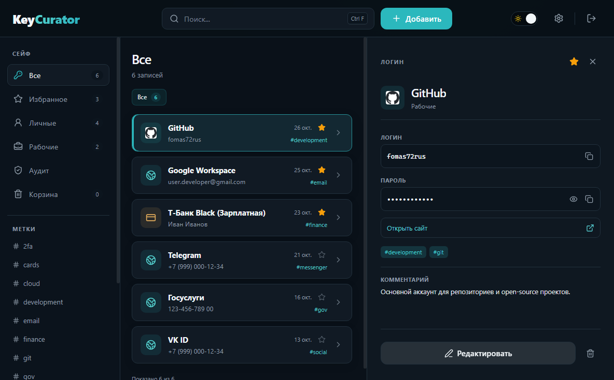
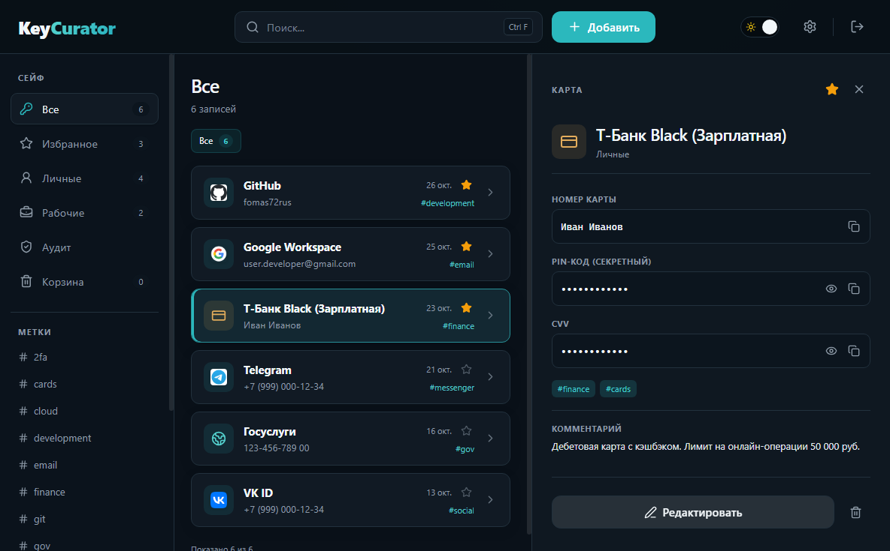
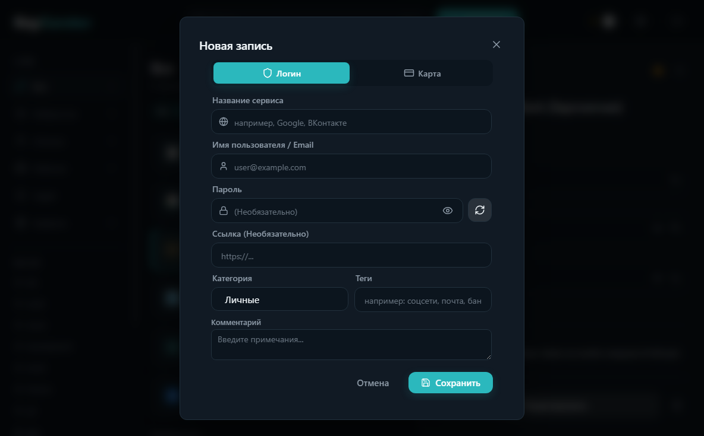
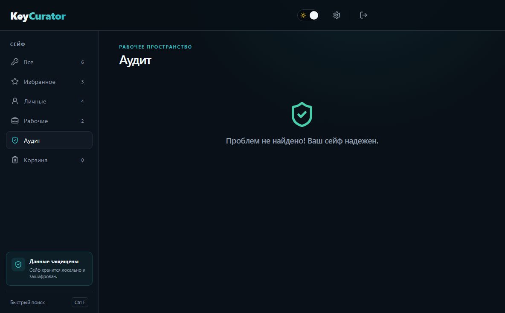
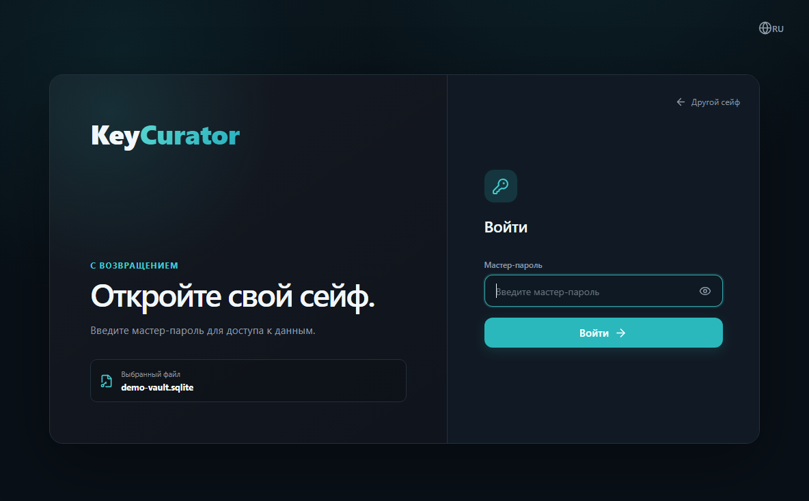

<div align="center">


# KeyCurator

**Безопасный, локальный и полностью автономный менеджер паролей для Windows.**

[](https://github.com/fomas72rus/keycurator-releases/releases/latest)
[-blue.svg?logo=windows)](https://github.com/fomas72rus/keycurator-releases/releases/latest)
[](https://github.com/fomas72rus/keycurator-releases)
[](https://github.com/fomas72rus/keycurator-releases)

<p align="center">
  <a href="#-скачать">Скачать</a> •
  <a href="#-интерфейс-приложения">Скриншоты</a> •
  <a href="#-особенности">Особенности</a> •
  <a href="#-безопасность">Безопасность</a> •
  <a href="#-системные-требования">Требования</a> •
  <a href="#-проверка-целостности-sha-256">Проверка SHA-256</a> •
  <a href="#-инструкция-по-установке-и-обновлению">Установка и обновление</a>
</p>

---

</div>

## 📥 Скачать

Готовые Windows-сборки актуальной версии **1.10.1**:

| Тип | Файл | Описание |
| :--- | :--- | :--- |
| 📦 **Установщик (Setup)** | [**KeyCurator-1.10.1-x64-Setup.exe**](https://github.com/fomas72rus/keycurator-releases/releases/download/v1.10.1/KeyCurator-1.10.1-x64-Setup.exe) | Стандартная установка в систему, интеграция с автозагрузкой, ярлыки на рабочем столе и в меню «Пуск». |
| 🚀 **Портативная версия (Portable)** | [**KeyCurator-1.10.1-x64-Portable.exe**](https://github.com/fomas72rus/keycurator-releases/releases/download/v1.10.1/KeyCurator-1.10.1-x64-Portable.exe) | Работает автономно без установки (данные изолированно сохраняются рядом в папке `KeyCurator-Data`). |

> Все релизы, история версий и контрольные суммы доступны на странице [Releases](https://github.com/fomas72rus/keycurator-releases/releases).

---

## 📸 Интерфейс приложения

<div align="center">

### Главное окно и избранное


<br/>

| Банковские карты | Создание и редактирование |
| :---: | :---: |
|  |  |

<br/>

| Аудит безопасности | Вход и разблокировка |
| :---: | :---: |
|  |  |

</div>

---

## ✨ Особенности

* **Полный офлайн и независимость**: данные хранятся исключительно на вашем компьютере в зашифрованном `.sqlite` файле. Никаких внешних серверов, облачных аккаунтов или подписок.
* ⭐ **Избранное (Favorites)**: быстрое добавление записей в избранное в один клик и отдельная удобная вкладка для быстрого доступа к главным сервисам.
* 🗑️ **Корзина на 7 дней (Trash / Soft Delete)**: защита от случайного удаления — удалённые записи отправляются в корзину и автоматически стираются через 7 дней. В любой момент запись можно восстановить.
* 🌐 **Иконки сервисов (Favicons)**: автоматическое скачивание и отображение фавиконок сайтов с локальным дисковым кэшированием для мгновенной работы без интернета.
* 🔔 **Встроенный контроль обновлений**: автоматическая ненавязчивая проверка новых релизов с GitHub при запуске приложения и ручная проверка в Настройках.
* 📦 **Зашифрованные резервные копии (`.kcbackup`)**: сохранение всех данных в защищённый файл по стандарту AES-256-GCM с PBKDF2 (600 000 итераций) с возможностью восстановления по паролю.
* **Логины и банковские карты**: удобное раздельное хранение учетных записей веб-сервисов и банковских карт (номер карты с автоформатированием, срок действия, CVV, держатель, PIN).
* **Мгновенный полнотекстовый поиск (SQLite FTS5)**: мгновенная фильтрация записей по названию, логину, заметкам и тегам.
* **История паролей**: сохранение истории предыдущих паролей и PIN-кодов с возможностью восстановления в один клик.
* **Встроенный генератор паролей**: гибкая настройка длины, регистра, цифр и спецсимволов с визуальным индикатором надёжности.
* **Аудит безопасности**: автоматическое обнаружение дублирующихся, скомпрометированных или слабых паролей.
* **Горячие клавиши (на любой раскладке)**:
  * `Ctrl + F` — быстрый переход в строку поиска;
  * `Ctrl + N` — быстрое создание новой записи;
  * `Ctrl + L` — мгновенная блокировка сейфа и очистка памяти.
* **Современный интерфейс**: продуманный эргономичный UI, Тёмная и Светлая темы, русский и английский языки.
* **PIN и автоблокировка**: быстрая разблокировка по PIN-коду и настраиваемый таймер автоматической блокировки при бездействии.

---

## 🔒 Безопасность

* **Шифрование базы SQLCipher**: локальная база данных полностью зашифрована на диске военным стандартом SQLCipher (AES-256).
* **Усиленный KDF**: ключ деривации формируется с помощью алгоритма PBKDF2-SHA-256 (600 000 итераций в строгом соответствии с рекомендациями OWASP).
* **Защита оперативной памяти (Memory Zeroing)**: при блокировке приложения, закрытии хранилища или выходе все пароли, логины, номера карт и заметки принудительно обнуляются в оперативной памяти.
* **Безопасность буфера обмена**: скопированные пароли автоматически удаляются из буфера обмена Windows через 30 секунд.
* **Изоляция окружения (Electron Sandbox)**: строгая изоляция Renderer-процесса (`nodeIntegration: false`, `contextIsolation: true`, включенная системная песочница).

---

## 💻 Системные требования

* **Операционная система**: Windows 10 или Windows 11 (64-bit / x64).
* **Процессор**: современный двухъядерный процессор с тактовой частотой от 1.6 ГГц.
* **Оперативная память**: от 2 ГБ RAM (рекомендуется 4 ГБ).
* **Свободное место на диске**: от 250 МБ свободного дискового пространства.

---

## 🛡️ Проверка целостности (SHA-256)

Перед первым запуском рекомендуется сверить контрольную сумму скачанного файла в PowerShell:

```powershell
Get-FileHash -Path "$HOME\Downloads\KeyCurator-1.10.1-x64-Setup.exe" -Algorithm SHA256
```

Эталонные контрольные суммы для версии **v1.10.1**:

```text
ec528353f11e9d5c973d1ba9317939f28324bfc9c6ef1f6acf1e43613f6b846e  KeyCurator-1.10.1-x64-Setup.exe
e299d61f04271bdd552144fe6c58e48490353e8ab0c402b3048eef109471c92d  KeyCurator-1.10.1-x64-Portable.exe
d036a1458c8559377899810e290b18f322cfb5a7a70bbfe2640bf9b65f7cbaf6  KeyCurator-1.10.1-x64-Setup.exe.blockmap
8fbcac1a2084fe6cdbdcb513913de5461ca7f5b70a88f31299b224bfd94f120d  latest.yml
```

> **Примечание**: Сборки пока не подписаны платным коммерческим EV-сертификатом. Windows SmartScreen при первом запуске может показать стандартное синее предупреждение. Нажмите *«Подробнее»* → *«Выполнить в любом случае»*, предварительно сверив SHA-256.

---

## 🔄 Инструкция по установке и обновлению

### Новая установка:
1. Скачайте `KeyCurator-1.10.1-x64-Setup.exe` (или `KeyCurator-1.10.1-x64-Portable.exe`).
2. Запустите инсталлятор и следуйте подсказкам мастера установки.
3. При первом запуске нажмите **«Создать новое хранилище»**, выберите место сохранения `.sqlite` файла и задайте надёжный мастер-пароль.

### Обновление с предыдущей версии:
1. Скачайте новый файл установщика `KeyCurator-1.10.1-x64-Setup.exe`.
2. Закройте работающий KeyCurator.
3. Запустите установщик — он автоматически обновит бинарные файлы программы.
4. **Файл вашей базы данных (`.sqlite`) сохраняется на прежнем месте в полной безопасности** — запустите программу, введите мастер-пароль и продолжайте работу со всеми сохранёнными данными!
